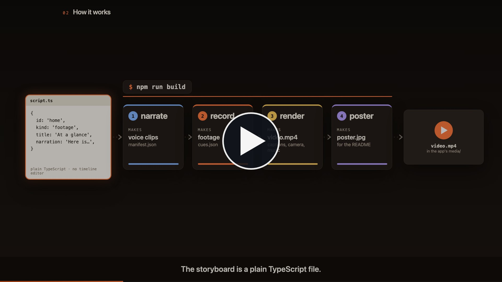

# EXPLAINER — automated explainer videos for your apps

[](https://ericediger.github.io/explainer/media/pipeline-explainer.mp4)

**[▶ Watch the 90-second explainer](https://ericediger.github.io/explainer/media/pipeline-explainer.mp4)** · made with the pipeline itself: [`videos/pipeline/`](videos/pipeline/)

One command turns a storyboard into a narrated, captioned product video plus a README poster:

```bash
npm run build          # narrate → record → render → poster   ⇒ <app>/media/<id>-explainer.mp4, <app>/media/explainer-poster.jpg
```

This folder lives at `_LOCAL APP DEVELOPMENT/EXPLAINER`, next to the apps it films. The finished video and
poster belong to the app, not to this project: each storyboard names its app with `appFolder`
(e.g. `'../FLIGHT DECK'`), and `render` and `poster` copy their result into that app's `media/` folder.
`out/` is only the build folder. `npm run deliver` copies the files again without re-rendering.

The pipeline is generic. Each video lives in `videos/<id>/` (storyboard, animated scenes, recorder
choreography); nothing under `scripts/` or `src/` knows about a particular app. With one video in the
folder the scripts pick it automatically; with several, choose with `VIDEO=<id> npm run build` or
`--video=<id>` on any single step.

Everything is code. Change a line of narration, re-run, and the voiceover,
the footage pacing, the captions and the camera moves all follow.

## How it works

```
videos/week-prep/script.ts     the storyboard: scenes, narration, routes, caveats
        │
        ├─ npm run narrate     scripts/narrate.ts  → public/week-prep/narration/*.wav + manifest.json
        │                      TTS: macOS `say` by default; ElevenLabs or OpenAI if a key is in .env.
        │                      Clips are cached by text hash, so only edited lines regenerate.
        │
        ├─ npm run record      scripts/record.ts   → public/week-prep/footage/*.mp4 + cues.json
        │                      Playwright drives the real app (served locally) with a visible
        │                      cursor, click ripples and a spotlight, one clip per scene, paced to
        │                      the narration. Zoom "cues" (element rectangles + timestamps) are
        │                      written alongside so the camera moves are computed, not hand-keyed.
        │
        ├─ npm run render      scripts/render.ts   → out/week-prep.mp4 → <app>/media/week-prep-explainer.mp4
        │                      Remotion composes: themed motion-graphics background, the video's own
        │                      animated scenes (cold open, how-it-works diagram, outro), footage in
        │                      a browser frame with smooth zooms, lower-thirds, sentence captions,
        │                      narration audio, music bed ducked under the voice, progress bar.
        │
        └─ npm run poster      scripts/poster.ts   → out/week-prep-poster.jpg → <app>/media/explainer-poster.jpg
                               One frame (spec.poster.atSec) with a play badge, for the README.

<app> is the storyboard's appFolder; without one, the files stay in out/.
```

Useful extras:

```bash
npm run studio                 # Remotion Studio: live preview, scrub the timeline
npm run record -- assistant    # re-record just one scene
npm run stills                 # one PNG per scene in out/stills/ for a quick visual check
npm run render -- --quality    # slower, higher-bitrate encode
```

## Narration voices

| Provider       | How to enable                                                  | Quality                         |
|----------------|----------------------------------------------------------------|---------------------------------|
| macOS say      | default, offline, free                                         | fine for cutting; robotic       |
| ElevenLabs     | `ELEVENLABS_API_KEY` (+ optional `ELEVENLABS_VOICE_ID`)        | broadcast-grade                 |
| OpenAI         | `OPENAI_API_KEY` (+ optional `OPENAI_TTS_VOICE`)               | very good                       |
| Your own voice | put `videos/week-prep/voice/<scene-id>.wav` (or mp3/m4a) files | you                             |

Copy `.env.example` to `.env`, add a key, run `npm run narrate`. `TTS_PROVIDER` forces a choice.
The voice is per video: `voice.elevenlabs` (or `voice.openai`) in `script.ts` wins over the `.env` default.

**Recording it yourself.** Read each scene's narration from `script.ts` into one file per scene,
named by scene id (`cold-open.wav`, `home.wav`, …). With `ASSEMBLYAI_API_KEY` set, `npm run narrate`
transcribes each clip and stores word timestamps in the manifest, so captions and the animated
beats land on the words you actually said instead of a proportional estimate.

Pronunciation fixes go in a scene's `spoken` field; `narration` is what the captions show.

## Background music

Drop a track under `public/<video>/music/` and point the storyboard at it:

```ts
music: { file: 'music/ready-to-move.wav', volume: 0.22, duckTo: 0.07, fadeOutSec: 3 },
```

`volume` is the level between narration lines and `duckTo` the level while a line plays
(ramped over `duckRampSec`, default 0.6 s); the bed fades in at the start and out at the end.
The track must be at least as long as the video. Only the render step reads it, so
`npm run render` is enough after changing the track or the levels.

## Adding another app

Everything app-specific lives in one folder:

```
videos/<id>/
├── script.ts      the storyboard: scenes, narration, routes, voice, theme, music, poster moment
├── record.ts      recorder choreography: one action per footage scene (click, spotlight, zoom cues)
├── scenes/        the animated scenes as React components (cold open, diagram, outro …)
└── index.ts       exports { spec, components } for Remotion
```

1. Copy `videos/week-prep/` to `videos/<id>/` and set `id`, `name`, `repoUrl`, `demoUrl`, `appFolder` (the app's
   folder next to this one, where the finished video and poster go), and
   `record` (a static folder + page to serve, or `url` of a dev server you already started, plus the viewport,
   and `readySelector` if the app's root element is not `#app`). For a narrow UI such as a browser side panel,
   lay the page out at 1600×900 and draw it with CSS `zoom` into a larger viewport (e.g. 2400×1350 with
   `dpr: 1`) so the camera can zoom in without blurring; videos/ctm-flight-deck/demo/stage.html does this.
2. Write the scenes in `script.ts`: `kind: 'animated'` scenes name a component; `kind: 'footage'`
   scenes name a hash route in the app. Narration is what the captions show; `spoken` fixes pronunciation.
3. Restyle: `theme` overrides any palette key (see `src/kit/theme.ts`) so the motion graphics echo
   the app; `style` picks a variant of each shared kit piece (see "Style presets" below);
   `voice.elevenlabs` picks the narrator; `music` adds a bed; `poster.atSec` picks the still.
4. Write `record.ts`: for each footage scene, drive the page with the `SceneRecorder` (`until`,
   `moveTo`, `click`, `type`, `spot`, `zoom`, `zoomUnion`, `eval`) paced to the narration length.
5. Rewrite or replace the components in `scenes/` and register them in `index.ts`.
6. Add the folder to `videos/index.ts`. `VIDEO=<id> npm run build`.

Footage scenes are generic: anything the app can be driven to in a browser can be recorded.
For a native app, swap the Playwright recorder for a screen capture and hand-write the cues.

`videos/pipeline/` is the worked example of a project with no UI of its own (this pipeline): its footage
comes from a small stage page, `demo/stage.html`, that lays the real artifacts of another video's run
(storyboard, narration clips, recorded footage and cues, a rendered excerpt) next to a terminal. The
terminal output is replayed, not re-run, and each scene carries an on-screen note saying so.

## Style presets

Two videos on the same kit look like siblings unless the kit itself changes shape. `style` in the storyboard
picks a variant of each shared piece; every key is optional and the defaults reproduce the original look:

```ts
style: { frame: 'bare', captions: 'bar', lowerThird: 'chapter-card', background: 'paper', transition: 'slide' },
```

| Key          | Variants                                   | What changes                                                        |
|--------------|--------------------------------------------|---------------------------------------------------------------------|
| `frame`      | `mac` · `bare` · `window`                  | browser window with traffic lights · full-bleed hairline frame · floating tilted window |
| `captions`   | `pill` · `bar` · `none`                    | centred rounded box · full-width strip at the bottom · off          |
| `lowerThird` | `bar` · `chapter-card` · `none`            | numbered bar top-left · centred title card that settles into a label · off |
| `background` | `glow-grid` · `flat` · `mesh` · `paper`    | drifting grid with glows · plain gradient · slow gradient blobs · light sheet with grain |
| `transition` | `fade` · `slide` · `zoom-through`          | how one scene hands over to the next                                |

Pair `paper` with a light theme (`bg0`, `ink`, `muted`, `captionBg`, `captionInk` …) and `theme.display`
for a headline face; the INVEST-IGATOR video is the worked example of the inverse of week-prep's dark stage.

## Honesty notes baked into the week-prep video

- The public demo page has no API key, so the assistant's reply in the "Assistant" scene is a
  scripted stand-in injected by the recorder. The drawer, proposal cards and Apply logic are the
  app's real code, and the scene carries an on-screen note saying so.
- All data shown is the demo page's fictional sample week.

## Requirements

- Node 20+.
- `npm install`, then `npx playwright install chromium ffmpeg` once per machine.
- Google Chrome installed is preferred for recording (`RECORD_BROWSER=chrome|chromium|/path` overrides).

Setting up on a new machine: bump every `remotion` / `@remotion/*` entry in `package.json` to the
current release before `npm install`; they must all match.

### Things that bit once

- Forcing `TTS_PROVIDER=elevenlabs` without a key makes `narrate` fail; leave it unset to auto-pick.
- A long render can occasionally time out with "waiting for the page to render ... frame N"; it is
  not deterministic. Re-run `npm run render` (narration and footage are cached).
- Remotion's bundled ffmpeg is a slim build without analysis filters (`volumedetect` etc.). Measure
  loudness with a small script that reads the WAV samples instead.
