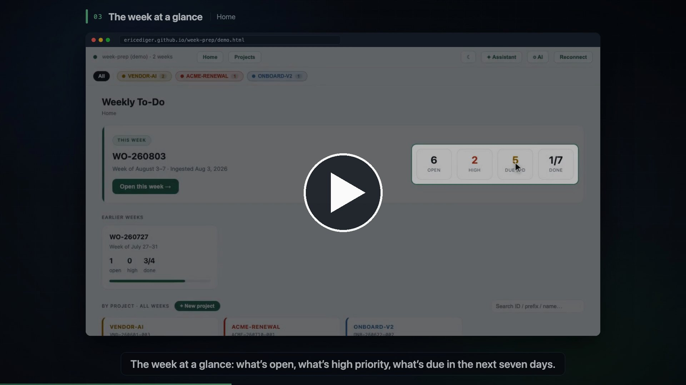

# Week Prep — a weekly rollover to-do list

**[▶ Watch the 2-minute explainer](https://ericediger.github.io/week-prep/media/week-prep-explainer.mp4)** · **[Try the live demo](https://ericediger.github.io/week-prep/demo.html)**

A single-file, local-first weekly to-do app. Drop your week's raw material — meeting notes, emails, screenshots, PDFs — into a folder, and the app uses Claude to turn it into a prioritized action list. Unfinished items roll over to the next week automatically.

